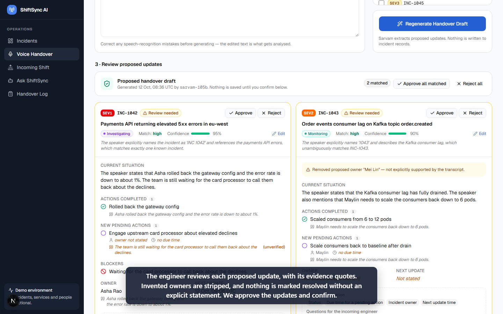
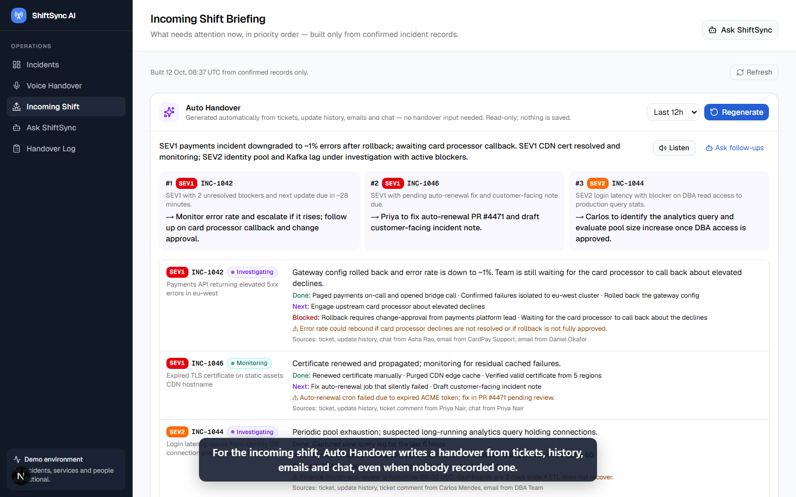
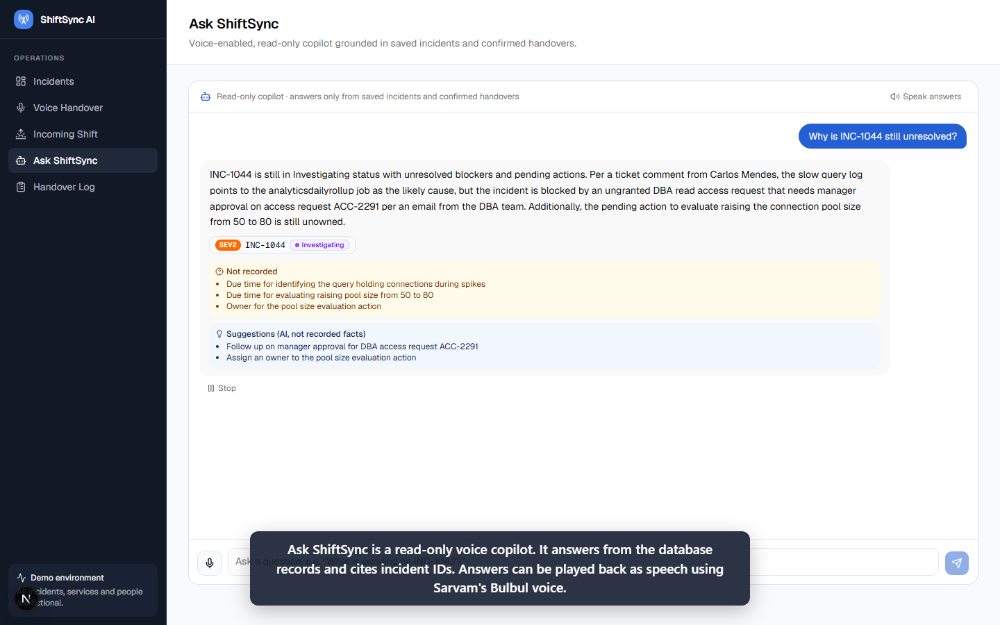
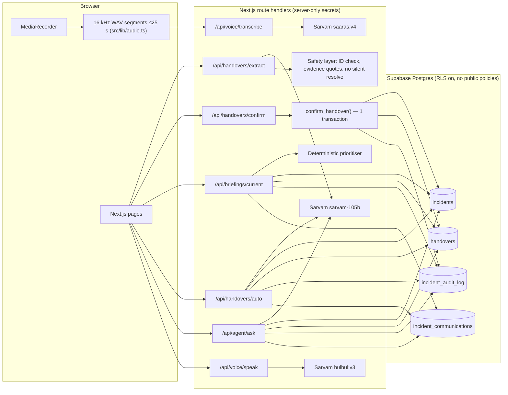

# ShiftSync AI

Voice-first shift handover for 24×7 IT operations, built on **Sarvam AI** and **Supabase**.

**Live demo: https://shift-ai-rouge.vercel.app/** (no login needed)

The outgoing engineer speaks a handover. ShiftSync transcribes it, extracts structured per-incident updates, and has a human confirm them before they're saved, with a full audit trail. It then produces a prioritised briefing for the incoming shift. If nobody recorded a handover, **Auto Handover** writes one from tickets, history, emails and chat. The incoming engineer can ask a voice agent questions and hear the answers.

> Everything here (incidents, services, people, emails) is **fictional sample data**. No company code, APIs or credentials are used.

```
Voice ─▶ Sarvam STT ─▶ editable transcript ─▶ Sarvam LLM extraction ─▶ human review/edit
     ─▶ atomic confirm (Supabase txn + audit) ─▶ incoming-shift briefing ─▶ Ask ShiftSync (voice) ─▶ Sarvam TTS
                                   no handover? ─▶ Auto Handover (tickets + history + emails/chat)
```

## For judges

| | |
| --- | --- |
| **Track** | ShiftAI |
| **Live app** | **https://shift-ai-rouge.vercel.app/**. No login is needed; open it and use the left sidebar. Health check: [/api/health](https://shift-ai-rouge.vercel.app/api/health) |
| **Demo video** | `https://youtu.be/<to-be-added>` (3 min 17 s, narrated) |
| **Technical design document** | [docs/TECHNICAL_DESIGN.md](docs/TECHNICAL_DESIGN.md): overview, architecture and flow diagrams, setup and deployment, code walkthrough, assumptions |
| **Tests** | `npm test`: 42 tests, about 93% line coverage (`npm run test:coverage`) |

**Suggested 3-minute tour of the live app:**
1. **Incidents**: open `INC-1042`.
2. **Voice Handover**: click *Record* (or *Type instead*) and say, for example: *"INC 1042, Asha rolled back the gateway config, errors down to 1 percent, Asha gives the next update in 30 minutes."* Then *Transcribe*, then *Generate Handover Draft*. Extraction takes about 30 s.
3. Review the evidence quotes, **Approve**, then **Confirm**. Reopen `INC-1042` to see the before → after history.
4. **Incoming Shift**: Auto Handover plus the priority briefing. Click *Listen*.
5. **Ask ShiftSync**: ask *"Why is INC-1044 still unresolved?"*

All data is fictional.

| Review with evidence | Incoming-shift briefing | Voice copilot |
| --- | --- | --- |
|  |  |  |

## Features

| Page | What it does |
| --- | --- |
| **Incidents** `/` | Live dashboard with stats, search, severity/status filters, incident detail, audit trail and update history |
| **Voice Handover** `/handover` | Record (MediaRecorder), upload or type. Sarvam STT, editable transcript, AI draft, then per-incident **approve / reject / edit**, assign unmatched items, **confirm** |
| **Incoming Shift** `/briefing` | **Auto Handover** generated on page open, plus a deterministic priority briefing: overdue, blockers, upcoming follow-ups, owner gaps, next actions, AI recommendations kept separate. Filters and refresh. |
| **Ask ShiftSync** `/assistant` | Read-only voice/text copilot grounded in Supabase records, cites incident IDs, spoken answers with play/stop/replay |
| **Handover Log** `/handovers` | Every confirmed handover, with original and edited transcript, review decisions and applied changes |

## Architecture



**Stack:** Next.js 16 (App Router, Cache Components) · TypeScript · Tailwind v4 · shadcn/ui (Base UI) · Zod 4 · Supabase · Sarvam AI (REST, no SDK).

## Setup

```bash
npm install
cp .env.example .env.local      # fill in the values below
```

| Variable | Notes |
| --- | --- |
| `SUPABASE_URL` | Project URL |
| `SUPABASE_SERVICE_ROLE_KEY` | Secret key (`sb_secret_…`) or legacy service_role key. **Server only.** |
| `SARVAM_API_KEY` | Sarvam API subscription key. **Server only.** |
| `SUPABASE_DB_URL` | Optional. Session-pooler connection string, used only by `npm run db:migrate` |

1. **Schema:** paste [`supabase/setup.sql`](supabase/setup.sql) into the Supabase SQL Editor and run it. Alternatively, set `SUPABASE_DB_URL` and run `npm run db:migrate`.
2. **Seed fictional data:** `npm run seed`. This is idempotent. `npm run seed -- --reset` restores the original sample incidents and emails.
3. **Run:** `npm run dev`, then open http://localhost:3000. The microphone needs localhost or HTTPS.

The dev server prints a warning if configuration is missing, pages show a "configuration required / table missing" notice, and `/api/health` reports status. It returns booleans only and never values.

## API

| Method & route | Purpose |
| --- | --- |
| `GET /api/health` | Config presence and DB connectivity |
| `GET /api/incidents?q=&severity=SEV1,SEV2&status=` | Filtered list plus stats (400 on invalid values) |
| `GET /api/incidents/[id]` | One incident (400 bad ID, 404 unknown) |
| `POST /api/voice/transcribe` | multipart `file` (≤10 MB, ≤30 s), `languageCode` → `{ transcript }` |
| `POST /api/handovers/extract` | `{ transcript, incidentIds? }` → proposed draft. **Read-only.** |
| `POST /api/handovers/confirm` | `{ idempotencyKey, originalTranscript, editedTranscript, outgoingShift, incomingShift, decisions[] }` → 201 created, 200 replay, 409 stale/conflict, 404 unknown incident |
| `GET /api/handovers`, `GET /api/handovers/[id]` | Handover list and detail (with audit) |
| `GET /api/briefings/current` | Briefing built from persisted data only |
| `POST /api/handovers/auto` | `{ windowHours? }` → AI handover from records. **Read-only.** |
| `POST /api/agent/ask` | JSON `{ question, history? }` or multipart `audio` → answer, incident references, missing info, suggestions. **Read-only.** |
| `POST /api/voice/speak` | `{ text }` → `audio/mpeg` |

Errors always look like `{ "error": { "code", "message", "details?" } }`.

## Data model (Supabase)

- **incidents**: id (`INC-####`), title, description, severity, status, affected_service, summary, actions_completed[], pending_actions[{description, owner, dueAt, status}], blockers[], owner, next_update_at, created/updated_at, update_history[], is_sample_data
- **handovers**: id, idempotency_key (unique), request_hash, original_transcript, edited_transcript, outgoing_shift, incoming_shift, submitted_by, status, incident_ids / approved / rejected, review (per-incident decisions, AI recommendations, missing info), created_at
- **incident_audit_log**: incident_id, handover_id, created_at, source, changed_fields, previous_values, new_values, confirmation_status
- **incident_communications**: fictional emails, chat and ticket comments per incident
- **confirm_handover(p_handover, p_updates)**: one transaction that runs the idempotency check, takes a row lock on each incident, does an optimistic concurrency check on `updated_at`, applies updates and history, and writes audit rows. Any failure rolls back everything.

All tables have RLS enabled with no policies, so only the server's secret key can access them.

## Safety rules

- **Extraction never writes.** The model's incident IDs must exist in the database. Unknown or low-confidence matches are returned as unmatched.
- **Evidence is checked against the transcript.** Every completed action, owner, time and status change needs a quote that the server finds in the transcript. A pending-action owner must be named in that action's own quote. Unverifiable items are flagged and are not pre-filled.
- **No silent "Resolved".** A resolution is only proposed on an explicit, high-confidence statement, and confirming it requires a separate "I confirm this is resolved" tick from the reviewer.
- **Confirmation only adds.** Omitted values are never erased. Blockers and pending actions change only through explicit reviewer choices. Only approved updates are persisted.
- **Model output is validated.** It goes through Zod with bounded retries, and malformed output is rejected with a 502.
- **The agent and Auto Handover are read-only.** They import only query functions, cite incident IDs, flag nonexistent IDs, and keep AI suggestions separate from recorded facts.
- **Secrets stay on the server.** No `NEXT_PUBLIC_` variables; keys and raw audio are never logged.

**Sarvam note:** `sarvam-105b` sometimes loops on whitespace under strict `json_schema` decoding. Extraction and Auto Handover therefore ask for unconstrained JSON with the schema in the prompt, validated with Zod, and fall back to strict mode. The agent uses a sectioned plain-text format, which answers in about 1–2 s.

## Testing

```bash
npm test               # 42 automated tests (no network): Node test runner + tsx
npm run test:coverage  # same, with a coverage report
npm run check:safety   # extraction safety rules on adversarial model output
npm run typecheck && npm run lint
npm run e2e            # LIVE: real Supabase + Sarvam through the running app
npm run live:extract   # LIVE: Sarvam extraction
npm run live:agent     # LIVE: Sarvam agent Q&A
npm run live:transcribe -- file.wav   # LIVE: long recording → chunked STT
```

Automated tests mock Supabase (PostgREST) and Sarvam at the `fetch` level. The real migration SQL and `confirm_handover()` run in an embedded Postgres (PGlite, test-only).

They cover:
- **Inputs:** invalid incident IDs, malformed and schema-invalid model output, missing owners and deadlines, ambiguous matches and resolutions, questions about nonexistent incidents.
- **Persistence:** duplicate confirmations (idempotent replay), rejected updates, stale versions, unknown incidents rolling back, DB failures returning 503.
- **Briefing:** sorting, and unknown deadlines never counting as overdue.
- **Agent:** read-only enforcement.
- **Sarvam failures:** auth 403, rate limit 429, timeout 504, audio over 30 s.

**Results (12 Oct 2026):**
- `npm test`: 42/42 passing.
- `next build`: passing.
- Live `npm run e2e`: passed end to end through extract → confirm → replay → persist → audit → briefing → agent → TTS.
- Live chunked STT: a 64 s handover was split into 4 segments, about 1.2–2.5 s each.
- Live extraction: 3/3 succeeded after the text-mode change.

## Known limitations

- No authentication. This is a single-tenant demo, and all access is server-side through the secret key.
- Speech-to-text uses Sarvam's synchronous API, so recordings are chunked in the browser into segments of 25 s or less. There is no real-time streaming.
- Extraction takes about 25–35 s, because `sarvam-105b` is a reasoning model.
- Emails and chat come from a fictional seeded table, not a real mailbox.
- Times are shown in UTC.

## Demo video

The demo video is generated reproducibly from the running app by the scripts in [`demo/`](demo/README.md): Playwright drives the UI, Sarvam TTS provides the narration, and ffmpeg composes the result.

## Deployment

See [docs/TECHNICAL_DESIGN.md §3.3](docs/TECHNICAL_DESIGN.md#33-deploy-to-vercel). Import the repository in Vercel and set the three server-side environment variables.

## 3-minute demo script

1. **0:00 Incidents.** "Eight fictional incidents are live in Supabase: SEV counts, search, filters." Open INC-1042 to show its situation, pending actions and history.
2. **0:25 Voice Handover.** Record: "INC 1042, Asha rolled back the gateway config, errors down to 1 percent, Asha gives the next update in 30 minutes. INC 1043 lag drained, Mei Lin needs to scale consumers back. Staging dashboards look better, not sure." Transcribe, fix a word, then Generate.
3. **1:05 Review.** Point out the evidence quotes, the "Requires review" card, the ambiguous dashboards item that was *not* marked resolved, and the stripped invented owner. Edit one field, approve INC-1042, reject one, then **Confirm**.
4. **1:40 Persistence.** Refresh INC-1042 to show the change history (before → after) and a link to the handover with its original transcript.
5. **2:00 Incoming Shift.** Auto Handover generates on open from tickets plus emails ("rollback CR-8812 awaiting approval, don't roll back manually"). Click **Listen**. Show the priority order and the reasons, overdue items and gaps.
6. **2:30 Ask ShiftSync.** Ask by voice, "Why is INC-1044 still unresolved?" The spoken answer cites the DBA email and ACC-2291. Then ask "Close INC-1043": it explains it is read-only.
