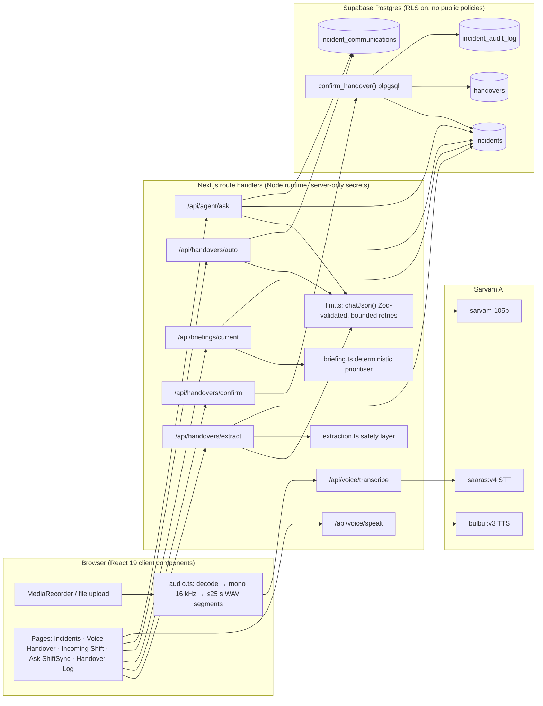
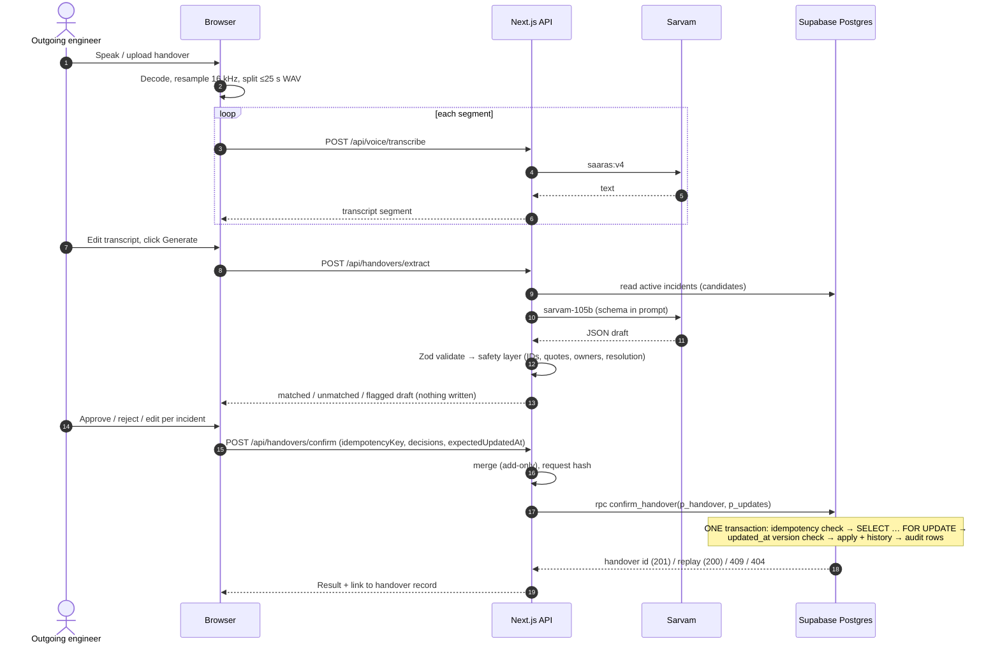
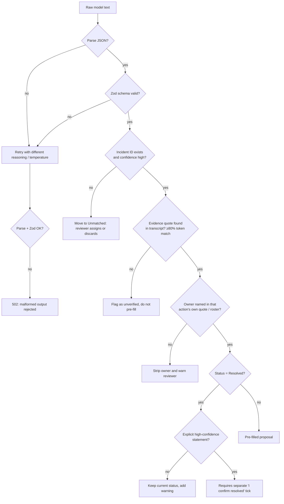
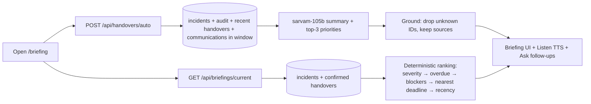
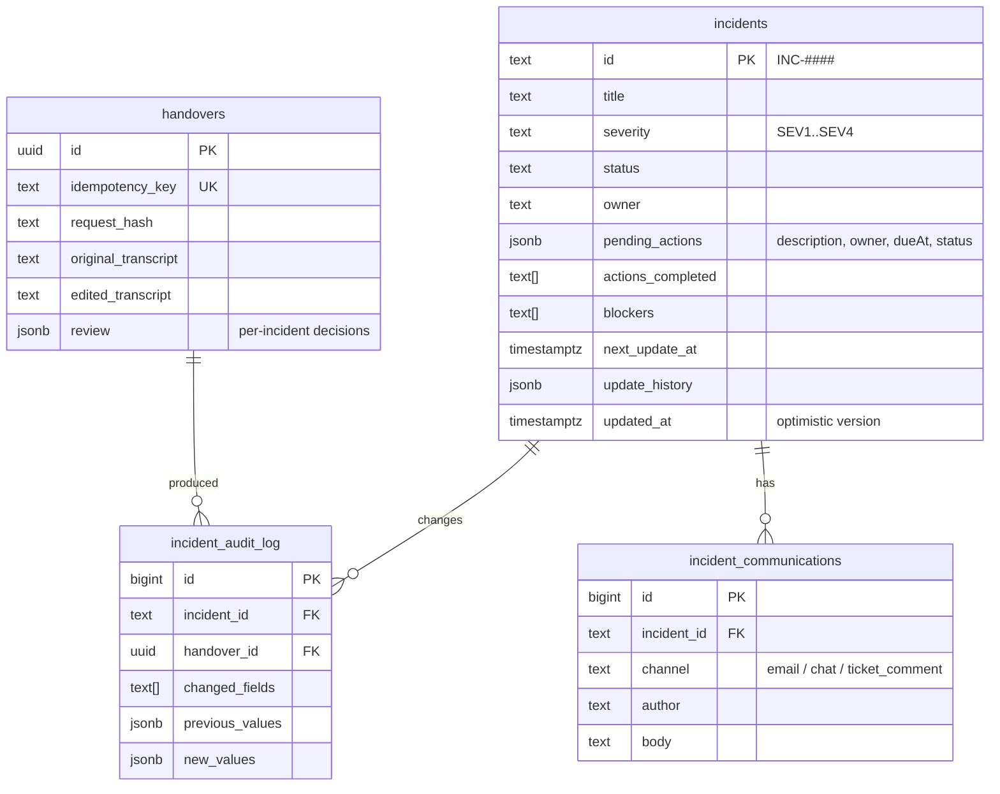

# ShiftSync AI: Technical Design Document

| | |
| --- | --- |
| **Project** | ShiftSync AI. Voice-first shift handover for 24×7 IT operations |
| **Hackathon track** | ShiftAI |
| **Repository** | https://github.com/ShirishHanchate/ShiftAI |
| **Live demo** | https://shift-ai-rouge.vercel.app/ (no login needed) |
| **Demo video** | _see README → "For judges"_ |
| **Stack** | Next.js 16 (App Router) · TypeScript · Tailwind v4 · shadcn/ui · Zod 4 · Supabase Postgres · Sarvam AI (STT `saaras:v4`, LLM `sarvam-105b`, TTS `bulbul:v3`) |

---

## 1. Project overview

### 1.1 Problem

In 24×7 IT operations (NOC, SRE, support desks), live incidents change hands at every shift change. Today that handover is a rushed call, a chat message or a half-filled spreadsheet, which causes four problems:

- **Context is lost.** Who rolled back what, which approval is pending, and who owns the next update.
- **Records go stale.** The ticketing system is not updated because typing up the handover takes too long.
- **Nobody is accountable.** No one can later say what was handed over, by whom, or what changed.
- **Shifts start blind.** The incoming engineer has to piece the situation together from tickets, email and chat.

### 1.2 Solution

ShiftSync lets the outgoing engineer **speak** the handover. The system turns that speech into **structured, evidence-backed incident updates**, and a human **reviews and confirms** them before anything is saved. Confirmed changes are written **atomically with a full audit trail**. The incoming engineer receives a **prioritised briefing** and can **ask questions by voice**.

| Capability | AI used | Design principle |
| --- | --- | --- |
| Voice handover capture (English plus 8 Indian languages, or auto-detect) | Sarvam `saaras:v4` STT | Browser-side chunking into ≤25 s 16 kHz WAV segments |
| Structured extraction (per-incident status, actions, owners, blockers, deadlines) | Sarvam `sarvam-105b` | **Every fact needs a verifiable transcript quote.** The model proposes and the human decides |
| Human review and atomic confirm | – | Single Postgres transaction, idempotent, with optimistic concurrency and audit |
| Incoming-shift briefing | Deterministic ranking (no LLM) | Explainable priority rules |
| Auto Handover (no handover recorded?) | `sarvam-105b` over tickets, history, email and chat | Read-only and grounded. Unknown IDs are dropped |
| Ask ShiftSync (voice copilot) | STT → `sarvam-105b` → `bulbul:v3` TTS | Read-only by construction. Cites incident IDs |

### 1.3 What makes it different

1. **An anti-hallucination safety layer.** The LLM output is not trusted. The server checks every quote against the transcript, every incident ID against the database, and every person against the transcript or roster. It never lets "resolved" through silently.
2. **Human-in-the-loop with real transactional guarantees.** AI drafts, a person approves, and Postgres enforces the result through row locks, version checks, idempotency and audit.
3. **Voice end to end, in Indian languages**, using one sovereign AI provider (Sarvam) for STT, the LLM and TTS.
4. **It works even when nobody hands over.** Auto Handover reconstructs the shift from tickets and communications.

---

## 2. System architecture

### 2.1 Component diagram



### 2.2 Main flow: voice handover → confirmed update



### 2.3 Extraction safety pipeline



### 2.4 Incoming-shift flow



### 2.5 Data model



All four tables have **Row Level Security enabled with no policies**. Only the server's secret key can read or write them, and the browser never talks to Supabase directly.

---

## 3. Setup and deployment

### 3.1 Prerequisites
- Node.js ≥ 20, npm
- A Supabase project (free tier is fine)
- A Sarvam AI API key (https://dashboard.sarvam.ai)

### 3.2 Local setup

```bash
git clone https://github.com/ShirishHanchate/ShiftAI.git
cd ShiftAI
npm install
cp .env.example .env.local        # fill in SUPABASE_URL, SUPABASE_SERVICE_ROLE_KEY, SARVAM_API_KEY
```

1. **Create the schema.** Paste `supabase/setup.sql` into the Supabase **SQL Editor** and run it. Alternatively, set `SUPABASE_DB_URL` and run `npm run db:migrate`.
2. **Seed fictional data:** `npm run seed`. It is idempotent, and `npm run seed -- --reset` restores the original data.
3. **Run:** `npm run dev`, then open http://localhost:3000. The microphone requires localhost or HTTPS.
4. **Health check:** `GET /api/health` returns configuration and database status as booleans only.

### 3.3 Deploy to Vercel

1. Import the GitHub repository in Vercel (framework: Next.js, no build overrides needed).
2. Add **Environment Variables** for Production and Preview: `SUPABASE_URL`, `SUPABASE_SERVICE_ROLE_KEY` and `SARVAM_API_KEY`. They stay server-side, and none use the `NEXT_PUBLIC_` prefix.
3. Deploy. The schema and seed are run once from a local machine as in §3.2.
4. Verify with `https://<your-app>.vercel.app/api/health`, which should report `"status":"ok"`.

CLI alternative:
```bash
vercel link
vercel env add SUPABASE_URL production
vercel env add SUPABASE_SERVICE_ROLE_KEY production
vercel env add SARVAM_API_KEY production
vercel --prod
```

### 3.4 Quality commands

```bash
npm test               # 42 unit/integration tests, no network
npm run test:coverage  # same with coverage report
npm run check:safety   # extraction safety rules on adversarial model output
npm run typecheck && npm run lint && npm run build
npm run e2e            # LIVE end-to-end against a running app (real Supabase + Sarvam)
```

---

## 4. Code walkthrough

```
src/
  app/                      Next.js App Router
    page.tsx                Incidents dashboard
    handover/               Voice Handover (record → transcribe → extract → review → confirm)
    briefing/               Incoming Shift (Auto Handover + priority briefing)
    assistant/              Ask ShiftSync (voice copilot)
    handovers/              Handover log + detail (original vs edited transcript, decisions)
    incidents/[id]/         Incident detail + audit trail
    api/                    Route handlers (thin: validate → call lib → map errors)
  lib/                      All business logic (server-only unless noted)
  components/               UI (shadcn/ui + Base UI)
  types/                    Shared TypeScript domain types
supabase/                   SQL migrations + one-shot setup.sql
scripts/                    seed, migrate, live checks, e2e
tests/                      Node test runner suites (mocked Sarvam/Supabase + embedded Postgres)
demo/                       Reproducible demo-video generator (Playwright + ffmpeg)
```

| Module | Responsibility |
| --- | --- |
| `lib/sarvam.ts` | Thin REST client for STT, chat and TTS. Uses timeouts and maps Sarvam errors (401/403, 429, 5xx, timeout) to typed `ApiError`s. Never logs keys or audio |
| `lib/llm.ts` | `chatJson()` takes a Zod schema and a list of attempts. It extracts the outermost JSON object, validates it, and retries with different reasoning or temperature settings. Malformed output is never returned. Supports `text` mode (schema in the prompt) and strict `json_schema` mode |
| `lib/extraction.ts` | Builds the extraction prompt from the transcript and candidate incidents, then runs the **safety post-processing**: ID verification, evidence quote matching (normalised exact match or ≥80% token coverage), owner support (full name in the transcript, or the first name of a known roster person), bounded due dates, and the resolution guard. It returns a `HandoverDraft` and writes nothing |
| `lib/handovers.ts` | `mergeIncidentChanges()` is a pure, **add-only** merge. Omitted values are never erased, blockers or actions are removed only by explicit choice, and it produces an audit diff. `requestHash()` and `confirmHandover()` call the `confirm_handover` RPC and map SQL error codes (`SS409`, `SS404`, `SS412`) to HTTP status codes |
| `supabase/migrations/0002_*.sql` | `confirm_handover(p_handover, p_updates)` runs in **one plpgsql transaction**: idempotency lookup (same key and same hash → replay, different hash → 409), `SELECT … FOR UPDATE` per incident, an `updated_at` version check, then writing the update and history and inserting audit rows. Any exception rolls back everything |
| `lib/briefing.ts` | A pure, deterministic prioritiser (`comparePriority`, `compareActions`, `isOverdue`). Unknown deadlines are never treated as overdue. AI recommendations come from the latest approving handover and are shown separately |
| `lib/auto-handover.ts` | Builds a compact payload from incidents, audit, handovers and communications within a time window. The LLM summarises it, and `groundAutoHandover()` drops any incident IDs that don't exist |
| `lib/agent.ts` | The read-only copilot. `extractIncidentIds()` normalises "inc 1042" and similar forms. Context retrieval follows up on the previous turn's incidents, and the model replies in a sectioned plain-text format parsed by `parseAgentReply()`, which is Zod-validated. `finalizeAnswer()` flags fabricated IDs. The module imports **query functions only** |
| `lib/audio.ts` (client) | Decodes any recorded or uploaded format, downmixes to mono, resamples to 16 kHz, splits into ≤25 s segments, encodes WAV, and detects silence |
| `lib/audio-upload.ts` | Server-side upload validation: size, magic bytes, WAV duration (≤30 s) and language whitelist |
| `lib/validation.ts` | Zod schemas for every API body and query |
| `lib/api.ts` | A uniform error envelope `{ error: { code, message, details? } }`. Unknown errors become safe 500s |
| `lib/env.ts` | Lazy required-env access with `ConfigError`, and `configStatus()` booleans for `/api/health` |

### 4.1 Testing strategy

There are **42 automated tests** using the Node built-in test runner and `tsx`, and they need **no network**:

- **`tests/api.test.ts`** runs route handlers end to end, with `fetch` mocked at the Supabase (PostgREST) and Sarvam boundaries. It covers validation (400), unknown incidents (404), DB failure (503), stale versions (409), idempotent replay, extraction never writing, read-only agent enforcement, Sarvam 403/429/timeout mapping, and audio over 30 s.
- **`tests/confirm-db.test.ts`** runs the **real migration SQL and `confirm_handover()`** inside embedded Postgres (PGlite). It covers atomic rollback on stale or unknown incidents, replay, and key reuse with a different body.
- **`tests/extraction-safety.test.ts`** feeds adversarial model output (fabricated quotes, invented IDs and owners, ambiguous "resolved") through the safety layer.
- **`tests/merge.test.ts`** checks add-only merge semantics and the audit diff.
- **`tests/briefing.test.ts`** checks priority ordering, overdue logic and recommendation separation.

Coverage (`npm run test:coverage`) is **≈93% lines, ≈82% branches, ≈89% functions** across the modules exercised. Live verification scripts (`npm run e2e`, `live:*`) exercise the real Supabase and Sarvam services.

---

## 5. Assumptions and limitations

**Assumptions**
- Single-tenant demo for one operations team. Access control is out of scope for the hackathon, and all data access is server-side with the secret key.
- Incident data, people, emails and chat are **fictional seed data** (`src/data/*`). A production version would connect to the team's ticketing system (for example Jira or ServiceNow) and mail or chat.
- A handover mentions incidents by ID ("INC 1042") or a recognisable description. Anything the model cannot match confidently goes to *Unmatched* for the reviewer.
- The human reviewer is the source of truth. The AI only proposes.
- Times are stored and shown in UTC.

**Limitations and future work**
- No authentication or roles yet. The next step would be Supabase Auth or SSO, with per-team RLS policies.
- STT uses Sarvam's synchronous API with browser-side chunking, not real-time streaming.
- Extraction takes about 25–35 s because `sarvam-105b` is a reasoning model. A future version could stream partial drafts.
- Communications come from a seeded table, not a live mailbox or Slack.

---

## 6. Security and privacy

- Secrets exist only in server environment variables. There are no `NEXT_PUBLIC_` variables, and `.env*` files are git-ignored. `.env.example` contains placeholders only.
- Supabase RLS is enabled on every table with no public policies.
- Raw audio and API keys are never logged. `/api/health` returns booleans, not values.
- All inputs are Zod-validated. Uploads are checked for size, type, magic bytes and duration.
- LLM output is treated as untrusted input: it is validated, grounded and human-confirmed before any write.
